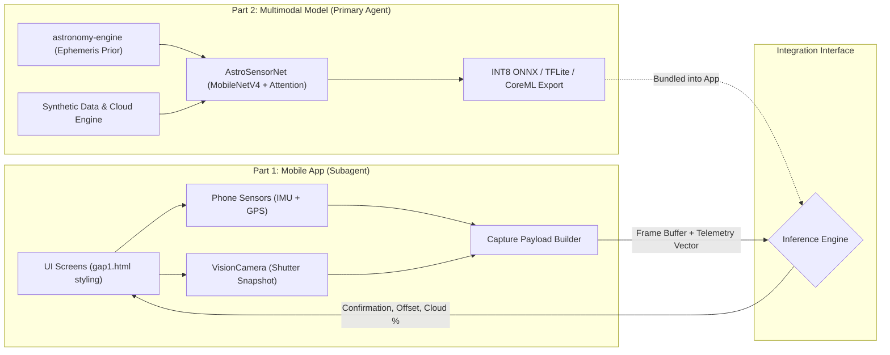

# CloudySpaceGolf: Master Implementation Plan

This master plan details the division of labor, milestones, directory architectures, and integration interfaces between:
* **Part 1 (Subagent)**: The React Native Mobile Application with real camera, sensor fusion HUD, and `gap1.html` UI.
* **Part 2 (Primary Agent)**: The Multimodal ML & Physics-Guided Fusion Engine, Synthetic Data Pipeline, Model Training, and On-Device Export.

---

## High-Level Architecture & Interaction Contract



---

## Part 1: Subagent Implementation Plan (React Native App)

### 1. Scope & Core Objectives
* Build the complete mobile client in React Native (Expo SDK 52+ with Config Plugins / Prebuild).
* Replicate the exact layout, color scheme, typography, and UX flow of `gap1.html` without superficial bloat.
* Integrate native hardware:
  * Real camera viewfinder and photo capture with low-light exposure settings.
  * Real device orientation (magnetometer + accelerometer/gyroscope) with exponential moving average (EMA) jitter smoothing.
  * Fallback manual sliders for compass and tilt to guarantee emulator testability.
* Manage game state (unlocked 24-patch celestial grid, user points, active hole challenges).

### 2. Directory Structure
```
CloudySpaceGolf/
├── app.json
├── package.json
├── tsconfig.json
├── src/
│   ├── theme/
│   │   ├── colors.ts            # Direct tokens from gap1.html (--bg, --panel, --gap, --amber, etc.)
│   │   └── typography.ts        # Serif headings + sans-serif body
│   ├── types/
│   │   ├── telemetry.ts         # Orientation, GPS, timestamps
│   │   ├── game.ts              # SkyPatch (24 tiles), Challenge/Hole, Score
│   │   └── capture.ts           # Capture payload, VerificationStep
│   ├── hooks/
│   │   ├── useDeviceOrientation.ts # Magnetometer/accel fusion with low-pass EMA
│   │   ├── useEphemeris.ts         # Calculates target Alt/Az via astronomy-engine
│   │   ├── useLocation.ts          # GPS tracking & permissions
│   │   └── useGameState.ts         # Zustand store with MMKV persistence
│   ├── components/
│   │   ├── CloudRadarMap.tsx       # Animated SVG radar map (clouds, gaps, user pin)
│   │   ├── CameraViewfinder.tsx    # VisionCamera stream + target overlay
│   │   ├── ReticleOverlay.tsx      # Crosshair that turns amber when locked (<= 4°)
│   │   ├── ManualSliders.tsx       # Heading & tilt sliders (fallback/indoor)
│   │   ├── VerificationPipeline.tsx # 4-step async check animation
│   │   ├── SkyPatchGrid.tsx        # 8x3 celestial patches grid with pop animation
│   │   └── TabBar.tsx              # 4-button bottom tab navigation
│   └── screens/
│       ├── GapsScreen.tsx          # Tab 1: Map, gap alerts, gap list, indoor chase
│       ├── CaptureScreen.tsx       # Tab 2: Camera, reticle, capture button, result
│       ├── SkyMapScreen.tsx        # Tab 3: 24-patch progress, plate solving card
│       └── CrewScreen.tsx          # Tab 4: Spotter report feed, weekly leaderboard
```

### 3. Step-by-Step Subagent Milestones

| Milestone | Deliverables | Verification Criteria |
| :--- | :--- | :--- |
| **Milestone 1.1** | Project setup (Expo prebuild, TypeScript, react-native-reanimated, react-native-svg, lucide-react-native). Theme tokens & 4-tab bottom navigation matching `gap1.html`. | Tabs switch between screens with smooth state retention; theme matches `gap1.html` CSS in light/dark mode. |
| **Milestone 1.2** | Device orientation hook (`useDeviceOrientation`) combining compass & tilt sensors with EMA smoothing + manual fallback sliders. | Heading ($0^\circ-360^\circ$) and Tilt ($0^\circ-90^\circ$) update smoothly in the HUD; sliders override when in indoor/emulator mode. |
| **Milestone 1.3** | Live camera viewfinder (`react-native-vision-camera`) + on-screen celestial target projection. Amber lock ring triggers within $\le 4^\circ$ with haptic feedback. Overcast veil toggle. | Moving device moves the simulated/live target on screen; crosshair locks onto Jupiter when aligned. |
| **Milestone 1.4** | Capture action & verification sequence. Tapping "Capture" freezes image, bundles telemetry, plays step-by-step verification readout (sharpness, star catalog, planet confirmation, cloud cover), and renders result card. | Result card displays calculated points, angular offset, and unlocks the corresponding sky patch. |
| **Milestone 1.5** | Animated Cloud Radar map with drifting SVG clouds, 24-patch celestial progress grid with ring-pop unlock animation, and Crew leaderboard. | Gaps screen shows pulsing radar; capturing a target turns a fogged tile into a deep-space star tile on the Sky Map. |

---

## Part 2: Primary Agent Implementation Plan (Multimodal ML & Sensor Fusion)

### 1. Scope & Core Objectives
* Implement the celestial mechanics ephemeris engine for ground-truth Alt/Az prediction.
* Build a synthetic data generation engine blending astronomical starfields with real cloud masks and simulated phone camera noise.
* Train **AstroSensorNet** (MobileNetV4-Small backbone + Physics Prior MLP + Cross-Attention Head) to identify celestial bodies through cloud breaks despite $\pm 5^\circ$ to $15^\circ$ IMU drift.
* Export and quantize the model to INT8 ONNX / TFLite / CoreML format (< 8 MB, < 25 ms latency) ready for integration into the mobile client.

### 2. Directory Structure
```
CloudySpaceGolf/
└── ml/
    ├── requirements.txt
    ├── config/
    │   └── training_config.yaml    # Hyperparams, sensor noise bounds, target bodies
    ├── ephemeris/
    │   ├── celestial_engine.py     # VSOP87 / Skyfield ground-truth calculator
    │   ├── coordinate_transforms.py# Horizontal (Alt/Az) <-> Camera Pinhole (u,v)
    │   └── catalog_loader.py       # Yale Bright Star Catalog (BSC5) + Planets
    ├── data_generator/
    │   ├── render_starfield.py     # Synthesizes starfield & planet discs
    │   ├── cloud_overlay.py        # Blends SWIMCAT/HYDRA/Perlin cloud masks
    │   ├── sensor_noise.py         # Injects realistic IMU drift, GPS jitter, ISO noise
    │   └── generate_dataset.py     # Multiprocess pipeline creating training dataset
    ├── models/
    │   ├── visual_backbone.py      # MobileNetV4-Small feature extractor
    │   ├── physics_prior_mlp.py    # MLP encoding candidate [Δu, Δv, Vmag, Alt, Type]
    │   ├── cross_attention.py      # Cross-attends visual ROI with physical prior
    │   └── astro_sensor_net.py     # End-to-end multimodal model
    ├── training/
    │   ├── losses.py               # Multi-task loss (Class CE + Centroid L1 + Cloud BCE)
    │   ├── train.py                # PyTorch training harness with AdamW & OneCycleLR
    │   └── evaluate.py             # Precision/Recall under varying cloud cover (0%-90%)
    └── export/
        ├── export_onnx.py          # PyTorch -> ONNX graph export
        ├── quantize.py             # INT8 Post-Training Quantization (PTQ)
        └── benchmark.py            # Latency and memory benchmark on mobile runtimes
```

### 3. Step-by-Step Primary Agent Milestones

| Milestone | Deliverables | Verification Criteria |
| :--- | :--- | :--- |
| **Milestone 2.1** | Mathematical Ephemeris & Projection Engine (`celestial_engine.py`, `coordinate_transforms.py`). Computes topocentric Alt/Az for Jupiter, Mars, Venus, Saturn, and top 100 bright stars from GPS + UTC. Projects to camera pinhole coordinates $(u, v)$. | Tested against NASA JPL Horizons web service; agreement within $< 0.01^\circ$ (sub-arcminute accuracy). |
| **Milestone 2.2** | Synthetic Data & Cloud Blending Pipeline (`data_generator/`). Generates 50,000 synthetic cloudy-sky training samples combining rendered starfields, real cloud alpha masks (SWIMCAT/Perlin), Poisson-Gaussian camera noise, and injected IMU noise ($\mathcal{N}(0, 7^\circ)$). | Dataset inspectable as image + JSON telemetry pairs with clear labels and varying cloud cover (10% to 90%). |
| **Milestone 2.3** | AstroSensorNet Architecture Definition (`models/`). MobileNetV4-Small visual backbone + 3-layer Prior MLP + Cross-Attention fusion layer. Multi-task loss: Target classification + Subpixel centroid regression $(\delta x, \delta y)$ + Cloud clarity score. | Model initializes cleanly, passes forward pass with dummy batch $(B, 3, 256, 256)$ image + $(B, N_{cand}, 5)$ prior vector; parameter count $< 4.5\text{M}$. |
| **Milestone 2.4** | Training & Domain Adaptation (`training/train.py`). Pre-trained ImageNet weights transferred $\rightarrow$ trained on synthetic cloudy dataset $\rightarrow$ fine-tuned with ExDark low-light dataset samples. | Validation target accuracy $> 94\%$ on cloud breaks with up to $10^\circ$ sensor drift; false positive rejection $> 96\%$ on streetlights/airplanes. |
| **Milestone 2.5** | Model Export & Quantization (`export/`). Export PyTorch model to ONNX, quantize to INT8 TFLite / CoreML. Benchmarking latency and footprint. | Model size $< 8\text{ MB}$, inference time $< 25\text{ ms}$ on mobile CPU/NPU, zero accuracy degradation. |

---

## Part 3: Synchronized Integration & Delivery

### Contract: Capture Payload & Verification Response
1. **App Output (Payload sent to Verification Engine):**
   ```json
   {
     "imageUri": "file:///var/mobile/.../capture_102.jpg",
     "timestampUtc": "2026-11-08T08:35:12Z",
     "location": { "latitude": 42.8864, "longitude": -78.8784, "altitudeMeters": 182 },
     "telemetry": { "headingDeg": 118.4, "tiltDeg": 23.8, "rollDeg": -1.2 },
     "targetRequested": "Jupiter"
   }
   ```

2. **Model Output (Verification Result returned to App):**
   ```json
   {
     "isConfirmed": true,
     "identifiedBody": "Jupiter",
     "confidence": 0.962,
     "angularErrorDeg": 0.35,
     "cloudGapPercentage": 78.5,
     "opticalCentroid": { "x": 512, "y": 384 },
     "secondaryBodiesInFov": [
       { "name": "Mars", "confidence": 0.91, "offsetFromCenterDeg": 2.1 }
     ],
     "pointsAwarded": 120,
     "unlockedPatchKey": "2-1"
   }
   ```

### Execution Strategy: Parallel Implementation
* **Primary Agent** starts immediately on **Milestone 2.1** (Physics Engine) and **Milestone 2.2** (Synthetic Data Pipeline).
* **Subagent** starts immediately on **Milestone 1.1** (Expo app foundation & theme) and **Milestone 1.2** (Sensor hook & HUD).
* During development, the subagent uses the deterministic mock verification pipeline (identical to `gap1.html`) so mobile UI and sensor mechanics are 100% testable before the quantized model is dropped into the bundle.
