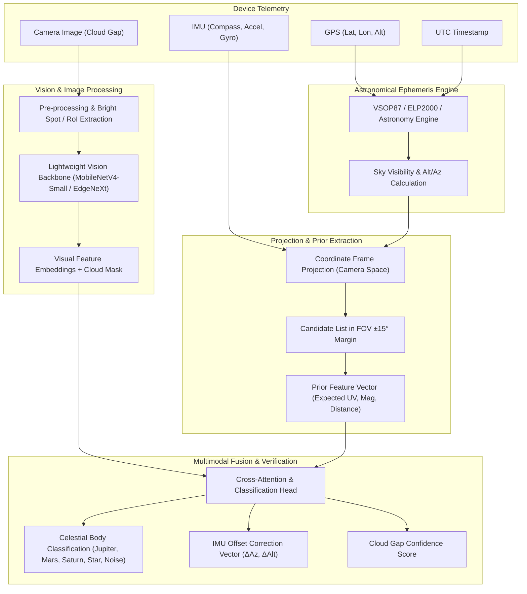

# CloudySpaceGolf: Multimodal Celestial Body Identification Plan

## 1. Problem Formulation & Objective

The objective is to identify celestial bodies (planets such as Jupiter, Mars, Venus, Saturn, and bright landmark stars) from smartphone camera images snapped during brief cloud breaks ("sucker holes"), augmented with simultaneous device telemetry:
* **Geolocation**: Latitude ($\phi$), Longitude ($\lambda$), Altitude ($h$)
* **Time**: High-precision UTC timestamp ($t$)
* **Attitude / Orientation**: Quaternion $q = (q_w, q_x, q_y, q_z)$ or Euler angles (Heading/Azimuth $A_{sensor}$, Pitch/Altitude $\theta_{sensor}$, Roll $\psi_{sensor}$) from the phone's IMU (accelerometer + gyro + magnetometer fusion)
* **Camera Intrinsics**: Field of View ($\text{FOV}_h, \text{FOV}_v$), focal length ($f_x, f_y$), principal point $(c_x, c_y)$
* **Night Sky Image**: $I \in \mathbb{R}^{H \times W \times 3}$ captured through cloud gaps

### Key Physical & Engineering Realities
1. **Sensors provide a rough cone, not ground truth:** Phone magnetometers typically have $\pm 5^\circ$ to $\pm 15^\circ$ error due to magnetic anomalies and uncalibrated drift. Accelerometers provide accurate tilt/gravity vectors ($\pm 1^\circ$), but yaw/compass is noisy.
2. **Standard astrometric plate solving fails under clouds:** Solvers like Astrometry.net require 10–30 clean stars to form recognizable geometric quads. In a cloudy sky break, only 1 or 2 bright points of light exist against dark clouds or light-polluted background haze.
3. **Pure end-to-end black-box ML is inefficient:** Training a neural net to predict celestial coordinates purely from raw GPS and timestamps forces it to learn celestial mechanics and orbital physics from scratch. Instead, **deterministic celestial ephemeris algorithms provide the physical prior**, and a **lightweight vision neural net resolves the optical ambiguity**.

---

## 2. System Architecture: Physics-Guided Multimodal Pipeline ("AstroSensorNet")

---

## 3. Mathematical Coordinate Pipeline (Physics Prior)

1. **Calculate Local Sidereal Time ($LST$):**
   $$LST = GMST(t_{UTC}) + \lambda$$
2. **Ephemeris Lookup:**
   Compute target Right Ascension ($\alpha$) and Declination ($\delta$) for all major planets and Hipparcos/Bright Star Catalog stars.
3. **Convert Equatorial $(\alpha, \delta)$ to Horizontal $(a, A)$:**
   $$\sin(a) = \sin(\phi)\sin(\delta) + \cos(\phi)\cos(\delta)\cos(H)$$
   $$\cos(A) = \frac{\sin(\delta) - \sin(\phi)\sin(a)}{\cos(\phi)\cos(a)}$$
   where $H = LST - \alpha$ is the local Hour Angle.
4. **Project to Camera Sensor Plane $(u_{pred}, v_{pred})$:**
   Using the device attitude rotation matrix $R_{world \to cam}$ and camera intrinsic matrix $K$:
   $$\mathbf{x}_{cam} = R_{world \to cam} \cdot \mathbf{v}_{celestial}(a, A)$$
   $$\begin{pmatrix} u_{pred} \\ v_{pred} \\ 1 \end{pmatrix} \sim K \mathbf{x}_{cam}$$
5. **Candidate Filtering:**
   Retain all celestial objects where $(u_{pred}, v_{pred})$ falls within the camera frame plus a tolerance margin $\Delta \theta_{sensor} \approx 12^\circ$ corresponding to worst-case IMU heading drift.

---

## 4. Lightweight Pre-Trained Model Selection & Architecture

For on-device edge execution (iOS CoreML / Android TFLite / ONNX Runtime), models must be lightweight (< 15 MB) and fast (< 30 ms inference).

### Recommended Model Backbones
| Backbone | Parameters | Latency (Mobile) | Primary Advantage |
| :--- | :--- | :--- | :--- |
| **MobileNetV4-Small** | ~3.8M | ~8 ms | Ultra-low power, optimized Universal Inverted Bottleneck (UIB) |
| **EdgeNeXt-Small** | ~5.6M | ~12 ms | Hybrid CNN-ViT; superior global context for diffuse cloud boundaries |
| **EfficientNet-Lite0** | ~4.7M | ~10 ms | Proven transfer learning stability on low-light edge vision |
| **YOLOv8-Nano (Detection variant)** | ~3.2M | ~11 ms | Direct bounding-box and centroid regression for point sources |

### Multimodal Fusion Architecture
1. **Visual Stream (Image $I$):**
   * Input: $256 \times 256$ crop around candidate bright spots or full downsampled frame.
   * Backbone yields a visual feature vector $f_{img} \in \mathbb{R}^{128}$ capturing PSF (point spread function) sharpness, color temperature (e.g. Mars red vs. Jupiter yellow-white), and surrounding cloud density/transparency.
2. **Sensor & Ephemeris Prior Stream (Vector $S_{prior}$):**
   * Features: Normalized relative camera offset $(\Delta u, \Delta v)$, expected visual magnitude $V_{mag}$, sensor estimated elevation $a_{sensor}$, target angular speed, and target celestial category ID.
   * Encoded via a 3-layer MLP with LayerNorm $\rightarrow f_{prior} \in \mathbb{R}^{64}$.
3. **Cross-Attention Fusion Layer:**
   * Keys/Values from visual features $f_{img}$, Queries from candidate priors $f_{prior}$.
   * Output heads:
     1. **Classification Head:** Softmax over $\{ \text{Target Planet (e.g. Jupiter)}, \text{Alternative Planet}, \text{Bright Star}, \text{Terrestrial Artifact (airplane/streetlamp)}, \text{Cloud/Noise} \}$.
     2. **Fine Centroid Offset ($\delta x, \delta y$):** Sub-pixel offset between candidate expected coordinate and true optical centroid in the image.
     3. **Cloud Gap Metric:** Segmented mask ratio indicating sky clarity percentage.

---

## 5. Training & Fine-Tuning Strategy

### The Data Challenge
There is no off-the-shelf dataset combining smartphone IMU telemetry with night sky cloud-gap photos. We resolve this via a **4-stage progressive training regimen**:

### Stage 1: Synthetic Night Sky & Cloud Break Simulator (Data Engine)
* **Astrophysical Simulation:** Render synthetic star fields and planetary discs using `astronomy-engine` / `Skyfield` matching exact coordinates $(lat, lon, t_{UTC})$ across 5,000 worldwide locations.
* **Photorealistic Noise & Atmosphere:**
  * Add realistic point-spread functions (Airy disk + lens aberration).
  * Add Poisson-Gaussian sensor noise (high ISO mobile sensor simulation, ISO 1600–12800).
  * Color temperature variations (light pollution skyglow: Bortle scale 4–8 gradients).
* **Cloud Synthesis:**
  * Apply Perlin/Simplex fractal noise and blend with real segmented cloud masks (from open datasets such as HYDRA, SWIMCAT, or all-sky observatory cameras).
* **Sensor Noise Simulation:**
  * Perturb ground-truth orientation by heading noise $\mathcal{N}(0, 7^\circ)$, tilt noise $\mathcal{N}(0, 1.5^\circ)$, and timestamp jitter ($\pm 2$ s).

### Stage 2: Transfer Learning from Pre-Trained Weights
* Initialize visual backbone from ImageNet-1k pre-trained weights.
* Freeze early feature-extraction layers; train the upper convolutional blocks on synthetic night-sky point source detection and cloud segmentation.

### Stage 3: Multimodal Joint Training
* Train the fusion MLP and cross-attention head using the synthetic dataset with injected IMU noise.
* Loss Function:
  $$\mathcal{L}_{total} = \mathcal{L}_{CE}(\hat{c}, c) + \lambda_1 \|\hat{\delta}_{uv} - \delta_{uv}\|_1 + \lambda_2 \mathcal{L}_{cloud\_mask}$$
  where $\mathcal{L}_{CE}$ is cross-entropy class loss and $\delta_{uv}$ is optical centroid refinement.

### Stage 4: Real-World Domain Adaptation & Calibration
* Capture a calibration set of ~300–500 real smartphone images under known conditions (clear nights, light clouds, various phone models).
* Apply low-learning-rate fine-tuning (LoRA or fine-tuning top 2 layers) to close the synthetic-to-real domain gap (compensating for real lens flares, mobile ISP sharpening artifacts, and real cloud edge diffraction).

---

## 6. On-Device Deployment Pipeline

1. **Model Export & Quantization:**
   * Export PyTorch model to ONNX.
   * Apply Post-Training Quantization (PTQ) to INT8 / FP16 using ONNX Runtime / CoreML Tools / TFLite converter.
   * Model footprint reduced to ~4–8 MB.
2. **Runtime Execution Flow in Mobile App:**
   1. User triggers "Capture" during cloud gap.
   2. Frame buffer + instant IMU quaternion + GPS snapshot are locked simultaneously into memory.
   3. C++ / JS WebAssembly `astronomy-engine` executes in < 2 ms, generating candidate prior vector.
   4. INT8 model runs inference via CoreML (iOS Neural Engine) or TFLite/NNAPI (Android) in ~15 ms.
   5. Result returned to React Native UI with confirmed target identification, confidence score, and sky unlock status.
